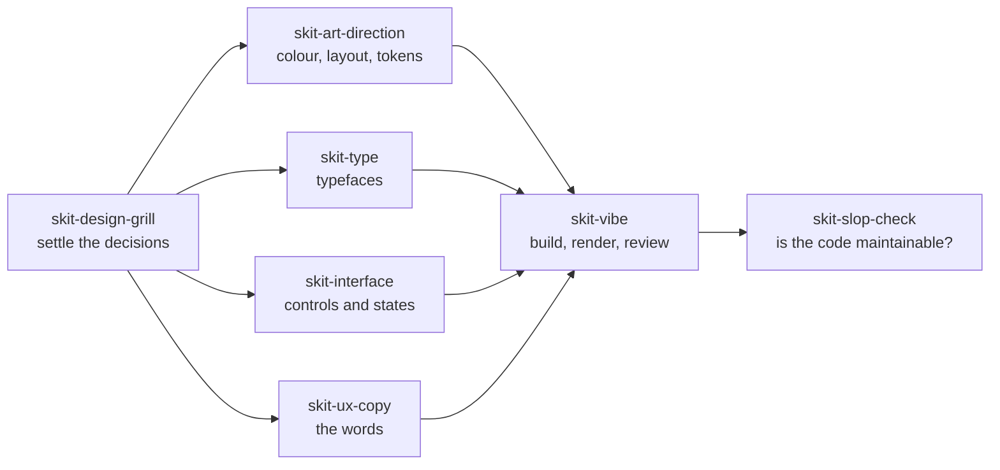

# skit

s-kit: Soti's kit. My skills for designing and building interfaces with an AI coding agent, plus a few for checking plans and code.

They tell the agent what a careful designer and reviewer would do: settle the decisions before building, pick the right type, cover the error and empty states, write the button labels properly, look at the rendered result, and catch code that a human will struggle to maintain.

The name is the prefix: every skill and agent here starts with `skit-`.

They work in Claude Code, Codex, Cursor and any other agent that reads `SKILL.md` skills.

## Install

### Claude Code (recommended)

```
/plugin marketplace add sudakshsoti/skit
/plugin install skit@skit
```

That installs every skill and the two helper agents.

**Getting updates.** The plugin has no version number: it follows every commit to `main`. Claude Code doesn't auto-update marketplaces you add yourself. To turn it on, run `/plugin`, open **Marketplaces**, choose **skit** and enable auto-update. Changes then arrive when Claude Code starts. Without it, run `/plugin marketplace update skit` whenever you want the latest.

### Codex, Cursor and other agents

```
npx skills add sudakshsoti/skit
```

Update later with `npx skills update`. The helper agents are Claude Code only; the skills fall back to doing the work themselves when the agents aren't there.

### claude.ai

Download this repo, zip any skill folder from `skills/` (for example `skills/skit-type`), and upload it under **Settings → Capabilities → Skills**. claude.ai doesn't update uploaded skills, so re-upload when a new release comes out.

## How the skills fit together

You don't have to use them in order; each one works alone. But for a new screen they line up like this:



Decisions you agree on during a grill are written to `design/decisions.md` in your project. The other skills read that file, so the agent doesn't ask again or override what you settled. A skill creates the file the first time it needs it.

## The skills

Most skills start on their own when your request matches. The ones marked manual run only when you call them. In Claude Code, type `/skit:<skill-name>` (for example `/skit:skit-vibe`; the plugin name comes first, so it reads doubled); elsewhere, ask for the skill by name.

### Design

**`skit-design-grill`** interviews you in rounds to settle how a screen should look and behave before anything gets built. It sticks to visible decisions (layout, states, copy, motion) and leaves code architecture alone.
> "Grill me on the design of the onboarding flow before we build it."

**`skit-art-direction`** sets the visual direction for a product UI. It first works out what kind of surface it's looking at, say a dense tool or a marketing page, then picks colour (in OKLCH), hierarchy, responsive layout and CSS tokens to suit it. For motion it uses Emil Kowalski's animation skill if you have it installed, and its own notes if you don't.
> "Give this settings app a visual direction. It feels flat and generic."

**`skit-type`** chooses typefaces and pairings, OpenType features and font loading, and checks coverage for other languages and scripts. It handles screen, print and brand work.
> "Pick a type pairing for a finance dashboard that also has to render Devanagari."

**`skit-interface`** covers how controls, forms, lists, dashboards and settings behave: structure, labels, focus order, hit areas and every field state. It's strict about the screens people forget, like loading, empty, error, partial and offline.
> "Review this signup form. What states am I missing?"

**`skit-ux-copy`** writes and audits interface text, from button labels and errors to onboarding, notifications and tone of voice. It ships with templates for the common cases.
> "Rewrite the error messages on the payment screen"

**`skit-vibe`** is the build loop for any interface change. It sizes the change first, so a colour tweak gets a quick pass and a new screen gets a plan, then builds, renders the result in a browser and reviews the screenshot before calling it done. In Claude Code it hands the build to the `skit-builder` agent and the review to `skit-critic`. Without those agents it does the same work in the main session and a fresh subagent, using the critic rules it carries in `references/critic.md`.
> "Add a filter bar to the orders table."

### Planning and review

**`skit-grilling`** is the design grill for any plan, decision or idea. It asks a few sharp questions per round, using your agent's question picker when it has one, until nothing important is left assumed. Inspired by Matt Pocock's `grilling` skill.
> "Grill me on this migration plan."

**`skit-plan-check`** runs after the agent proposes a non-trivial plan. It critiques the plan against a fixed checklist (unstated assumptions, contradictions, blind spots like rollback and data loss, over-engineering) and revises it.
> "Check that plan before you start."

**`skit-slop-check`** (manual) reviews AI-written frontend code for whether a person could maintain it. It looks for duplication, needless abstractions, vague names, silent failures and drift between sessions.
> "/skit:skit-slop-check src/components"

**`skit-autopilot`** works through a markdown checklist plan without stopping to ask. It verifies each item, ticks it off and commits before moving on, and uses subagents where your tool has them.
> "Run plans/dark-mode.md on autopilot."

### Session helpers

**`skit-handoff`** writes a structured handoff (decisions, progress, changed files, next steps) so the next session can pick up where this one stopped.
> "Write a handoff for the next session."

**`skit-bro`** (manual) restates the agent's last message in plain words, for when the answer was right but hard to read.
> "/skit:skit-bro"

## Agents (Claude Code)

`skit-builder` implements an approved UI plan or a small tweak in React, shadcn/ui, Tailwind CSS or plain HTML, and sends back screenshots. `skit-critic` reviews those screenshots and the code without editing anything, and returns ranked findings with a ship-or-fix verdict.

`skit-vibe` uses both, and you can call either one directly.

## Feedback

Bug reports and suggestions are welcome as [issues](https://github.com/sudakshsoti/skit/issues). Pull requests are by invitation, so please open an issue first.

## Licence

[MIT](LICENSE) © Sudaksh Soti
